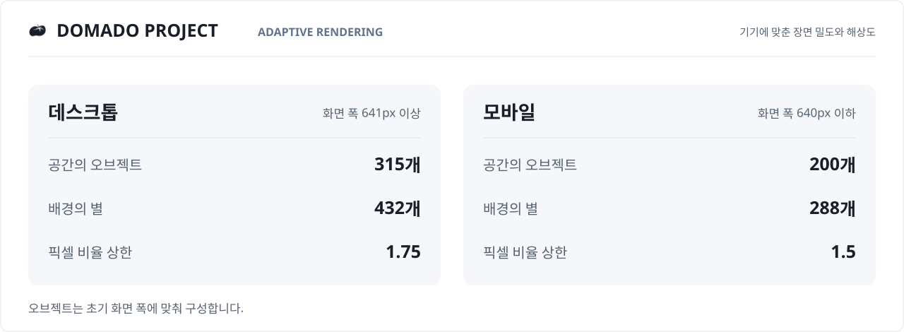

  <picture>
    <source media="(max-width: 640px)" srcset="assets/diagrams/hero-mobile.svg">
    
  </picture>

# DOMADO PROJECT

DOMADO PROJECT는 **여러 프로젝트와 개발 이야기를 하나의 3D 공간에서 만나는 브랜드 사이트**입니다. 
토마토, 신호등, 픽셀 로고와 작은 기기들이 검은 공간에 떠 있습니다. 
드래그로 둘러보고, 가까이 다가가고, 아이콘을 눌러 각 작업의 이야기로 이어집니다. 
입장 화면과 음악, 소개 카드, 연락을 보내는 종이비행기까지 하나의 경험으로 연결했습니다.  

1인 제작 · AI 협업 · 브랜드 기획 · 3D 모델링 · 인터랙션 · 사운드 구성 · 웹 구현과 배포

**[사이트 만나보기 ↗](https://domado-project.site/) · [구현 이야기](docs/ENGINEERING.md) · [개발 과정](docs/DEVELOPMENT.md) · [검증 기록](docs/VALIDATION.md)**

> 이 저장소는 DOMADO PROJECT의 경험과 구현 과정을 소개하는 공개 문서입니다. 
> 애플리케이션 소스는 비공개로 관리합니다. 
> 구현 설명과 수치는 2026-10-30 원본 `main`의 `c07175b`와 대조했습니다. 
> Hero와 프로젝트 소개의 3D 이미지는 실제 코드로 만든 모델을 렌더링했습니다.

 
 

## 01. 프로젝트 목록을, 둘러볼 수 있는 공간으로

웹 서비스, 픽셀 월드, 센서 플랫폼, 웨어러블까지. 
서로 다른 작업을 한곳에 소개하면서도 각자의 성격이 먼저 보이기를 바랐습니다.  

프로젝트를 상징하는 로고와 사물을 직접 입체로 만들고, 깊이가 있는 공간에 배치했습니다. 
아이콘에 반응을 주고 짧은 소개 카드를 연결해 **발견 → 이해 → 방문**의 흐름을 만들었습니다. 
공간 조작 없이 읽고 싶은 사람은 상단의 ‘프로젝트 소개’에서 같은 내용을 볼 수 있습니다.  

### 공간 안에서 만나는 것

<picture>
  <source media="(max-width: 640px)" srcset="assets/diagrams/project-gallery-mobile.svg">
  
</picture>

프로젝트 9개와 두 개의 기록 채널, 연락을 보내는 종이비행기. 
아이콘에서 소개를 읽고, 각 서비스와 저장소·개발 기록으로 이어집니다.  

## 02. 들어오는 순간부터, 이야기를 만날 때까지

<picture>
  <source media="(max-width: 640px)" srcset="assets/diagrams/experience-flow-mobile.svg">
  
</picture>

 

1. **작은 금속 토마토에서 시작합니다.** 
   첫 화면의 로고를 돌려볼 수 있습니다. 
   Explore를 누르면 사운드를 준비하고 브랜드 인트로로 넘어갑니다. 
2. **브랜드 모션이 공간으로 이어집니다.** 
   SVG 인트로와 음악이 함께 시작됩니다. 
   메인에서는 카메라가 이동하며 아이콘 사이로 들어가고, 제목 위로 빛이 지나갑니다. 
3. **아이콘을 발견하고 가까이 봅니다.** 
   마우스·터치로 회전하고 휠·핀치로 거리를 조절합니다. 
   PC에서는 호버로 이름과 반응을 보고, 터치에서는 먼저 라벨을 확인한 뒤 소개를 엽니다. 
4. **작업의 맥락을 읽고 연결됩니다.** 
   소개 카드의 탭으로 프로젝트를 바꾸거나 외부 링크로 이동합니다. 
   종이비행기와 토마토 메뉴에서는 연락 카드를 열 수 있습니다. 

 

**[모바일 화면과 조작 안내 →](docs/DEMO.md)**

 
 

## 03. 정적 웹 위에, 필요한 경험을 직접 연결했습니다

브라우저가 HTML·CSS·JavaScript 모듈을 읽고 Three.js로 공간을 그립니다. 
화면·입력·소리를 연결하는 코드는 역할별 모듈로 나누고, 프로젝트와 연락 카드는 네이티브 `dialog`를 사용했습니다. 
Vercel은 빌드된 정적 파일을 배포하며, 연락 폼은 브라우저에서 EmailJS REST API를 호출합니다.  

<picture>
  <source media="(max-width: 640px)" srcset="assets/diagrams/architecture-mobile.svg">
  
</picture>

 

| 구성 | 사용 기술 | 맡은 역할 |
|---|---|---|
| 화면과 상태 | HTML · CSS · JavaScript ES Modules · `dialog` | 진입 전환, 소개 카드, 메뉴, 초점과 상태 연결 |
| 입체 공간 | **Three.js 0.186.1** · OrbitControls · Raycaster | 절차적 모델, PBR 재질, 카메라 조작과 아이콘 선택 |
| 모션 | SVG · CSS · Web Animations API · 프레임 루프 | 브랜드 전환, 아이콘 반응, 제목과 카드 모션 |
| 소리 | Web Audio API · MP3 | 인트로와 메인 음악, 음소거, 탭 전환 시 재생 관리 |
| 연락 | 표준 `fetch` · EmailJS REST API | 입력 검증, 전송 요청, 성공·실패 피드백 |
| 배포와 분석 | Node.js 복사 빌드 · Vercel · Web Analytics | 정적 배포물과 페이지 분석 스크립트 연결 |

런타임 패키지 의존성은 `three` 하나입니다. 
React·별도 API 서버·DB·로그인은 사용하지 않습니다. 
AI는 제작 과정에서 함께 사용했으며, 방문자의 입력을 AI로 분석하는 서비스 기능은 없습니다.  

**[모듈 경계와 자원 관리 자세히 보기 →](docs/ENGINEERING.md)**

 
 

## 04. 눈에 보이는 움직임 뒤에서 다듬은 것

### 1. 확대해도 같은 감각으로 움직이게 하기

구 안쪽에서 둘러볼 때와 바깥으로 축소했을 때의 조작감이 달라지는 문제를 반복해서 확인했습니다. 
OrbitControls로 카메라 회전을 통일하고, 상하는 ±60°로 제한했습니다. 
휠의 픽셀·줄·페이지 단위를 반영하고, 휠 다음에 키보드 줌을 사용해도 거리가 튀지 않도록 현재 상태를 연결했습니다. 
핀치가 끝난 뒤 남은 손가락으로 드래그를 이어가는 흐름도 검사했습니다. 

 

### 2. 복제된 아이콘은 함께 쓰고, 반응은 따로 주기

로고와 기기는 외부 3D 모델 파일을 가져오는 대신 코드의 도형·경로·재질로 만들었습니다. 
복제본은 기본 geometry와 material을 공유합니다. 
신호등 점등, 워치 파형, 서버 팬처럼 개별 반응이 필요한 순간에만 해당 복제본의 자원을 분리합니다. 
한 아이콘을 건드렸을 때 같은 종류의 다른 아이콘까지 바뀌지 않도록 한 선택입니다. 

 

### 3. 화면이 바뀌어도 소리와 시간이 이어지게 하기

Explore를 누르기 전에는 음악 파일을 요청하지 않습니다. 
인트로 중 메인 음악을 미리 겹쳐 재생해 화면 전환 때 곡이 다시 시작되지 않게 했습니다. 
다른 탭으로 이동하면 재생과 진행 시간을 멈추고, 돌아오면 이어갑니다. 
음소거한 뒤 늦게 끝난 로딩이 음악을 다시 켜지 않도록 이전 요청을 구분합니다. 

 

### 4. 연락의 결과와 비행기 연출을 구분하기

전송 중에는 중복 제출을 막고, 성공 응답을 받은 뒤에만 폼을 비웁니다. 
오류·시간 초과가 나거나 카드를 닫았다 열어도 작성 중인 내용은 유지합니다. 
성공 뒤에는 평면 비행기가 같은 형상의 3D 모델로 바뀌어 날아갑니다. 
화면 변경으로 연출이 중단되어도 이미 확인한 전송 결과는 유지합니다.  

<picture>
  <source media="(max-width: 640px)" srcset="assets/diagrams/contact-flow-mobile.svg">
  
</picture>

 
 

## 05. 화면 크기에 따라, 그리는 양을 조절했습니다

데스크톱과 모바일의 렌더링 부담을 고려해 장면의 밀도와 해상도 상한을 다르게 구성했습니다. 
화면 폭에 따라 아이콘·장식과 배경 별의 수를 줄이고, 픽셀 비율에도 별도의 상한을 둡니다.  

<picture>
  <source media="(max-width: 640px)" srcset="assets/diagrams/render-budget-mobile.svg">
  
</picture>

 

카드·메뉴가 열렸거나 탭이 보이지 않을 때는 메인 장면 렌더링을 생략합니다. 
사용자가 움직임을 멈췄을 때도 장면 변화가 없으면 다시 그리지 않습니다. 
자세한 구성과 화면 변화에 따른 처리는 [렌더링 비용 관리](docs/ENGINEERING.md#4-화면-구성과-렌더링-비용을-따로-다루기)에 정리했습니다. 

 
 

## 06. 장면을 만든 뒤, 연결되는 순간을 다듬었습니다

| 과정 | 구현의 변화 |
|---|---|
| 10.27 · 첫 공간 | 로고를 입체화하고, 프로젝트 소개와 연결되는 3D 브랜드 공간 구현 |
| 10.28 · 진입 경험 | 금속 토마토, Explore, 브랜드 인트로, 음악과 제목 모션 연결 |
| 10.28 · 읽는 흐름 | 프로젝트·채널 카드, 모바일 라벨, 타이포그래피와 초점 처리 보강 |
| 10.29 · 공간 확장 | 기기 아이콘 5종, 개별 부품 반응, 별·링·성운, 카메라 조작 정리 |
| 10.30 · 연락과 연속성 | 연락 폼과 2D→3D 비행, 휠·키보드 연결, 메뉴와 카드 닫힘 전환 보강 |

같은 화면을 다시 확인할 수 있도록 아이콘 배치의 난수 시드를 고정했습니다. 
조작·모션·연락 상태를 계산과 UI로 나누고, 바뀌기 쉬운 경계에는 회귀 테스트를 남겼습니다.  

**[수정의 이유와 커밋별 개발 과정 →](docs/DEVELOPMENT.md)**

 
 

## 07. 검증한 것과 남은 확인

원본 `c07175b`에서 **테스트 184개 통과**, Node.js 문법 검사와 정적 빌드 통과를 확인했습니다. 
테스트 수는 기능·계산·상태 처리의 회귀 검사 결과이며, 성능이나 모든 기기의 동작을 보증하는 수치는 아닙니다.  

| 검증 층 | 확인한 내용 |
|---|---|
| 계산·모델 | 배치 재현성, 개수와 화면 맞춤, 유효한 형상·재질, 복제 자원 공유 |
| 입력·모션 | 회전·줌·핀치, 감속, 아이콘 반응과 복원, 탭 전환, 모션 감소 |
| 화면·소리 | 인트로 종료와 실패 복구, 늦은 응답 무시, 음소거와 재생 위치 유지 |
| 연락 | 입력 검증, 모킹한 성공·실패, 중복 방지, 오류 시 내용 보존 |
| 브라우저 | 데스크톱·모바일 크기에서 진입, 9개 프로젝트 탭, 연락 검증과 초안 보존 |
| 공개 문서 | 소스 해시·수치 대조, 내부 링크와 SVG 구조, 가로·세로 렌더링 |

이번 문서 검증에서는 실제 이메일을 발송하지 않았습니다. 
모바일 화면은 브라우저 에뮬레이션이며, iPhone·Android 실기기의 발열·FPS·배터리와 실제 청음은 별도 확인이 필요합니다.  

**[검증 환경·실행 명령·미확인 범위 →](docs/VALIDATION.md)**

 
 

## 08. 이 저장소에서 볼 수 있는 자료

| 자료 | 내용 |
|---|---|
| [체험 안내](docs/DEMO.md) | 실제 화면, 모바일 조작, 키보드와 대체 경로 |
| [구현 이야기](docs/ENGINEERING.md) | 모듈 경계, 3D·오디오·카드·연락의 상태 연결 |
| [개발 과정](docs/DEVELOPMENT.md) | 초기 구현부터 입력·모션·연락 흐름을 다듬은 기록 |
| [검증 기록](docs/VALIDATION.md) | 원본 회귀 검사, 브라우저 확인, 수치의 의미와 한계 |
| [이미지·SVG 안내](docs/ASSETS.md) | 원본 모델 렌더링, 캡처 조건, 도식과 출처 |

**[DOMADO PROJECT ↗](https://domado-project.site/) · [GitHub ↗](https://github.com/DOMADO-PROJECT) · [개발 이야기 ↗](https://velog.io/@supernova77/posts)**
