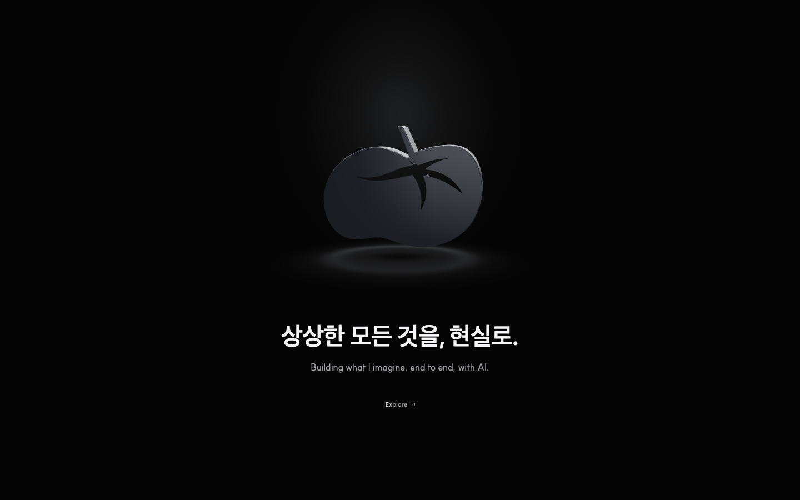
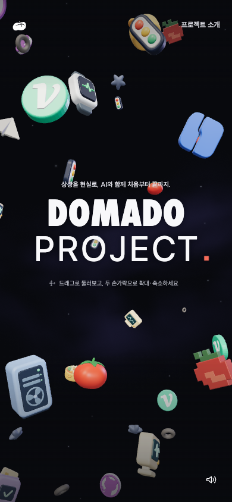
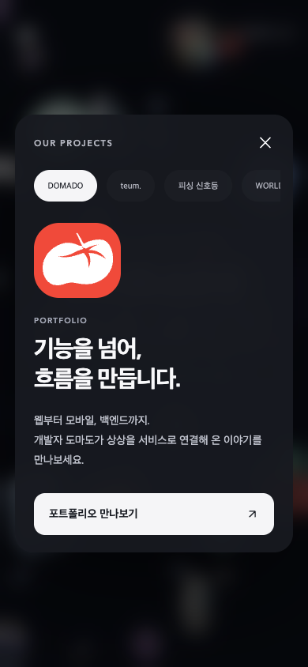
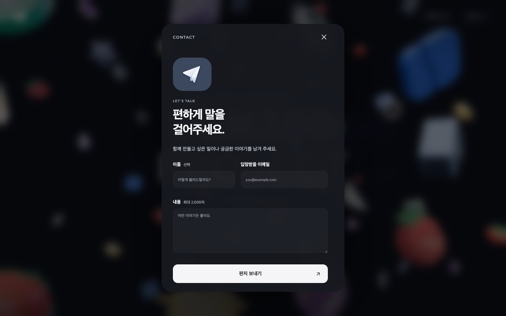

# 처음 둘러보기

[← README](../README.md) · [DOMADO PROJECT 열기 ↗](https://domado-project.site/)

 

## 1. 토마토를 만지고, Explore로 들어가기

첫 화면의 금속 토마토를 드래그하면 직접 돌려볼 수 있습니다. 
Explore를 누르면 브랜드 인트로를 지나 메인 공간으로 들어갑니다. 
음악은 이 클릭 이후에 준비하며, 소리를 재생할 수 없는 경우에도 입장할 수 있습니다.  

*실제 구현 · 1440 × 900. 캡처 시점에 따라 금속 로고의 방향과 빛이 달라집니다.* 

 
 

## 2. 공간을 둘러보고, 아이콘 이름 확인하기

마우스로 드래그하거나 방향키를 누르면 공간을 회전합니다. 
휠 또는 `+`·`−` 키로 확대·축소하고, `Home`으로 처음 시점에 돌아옵니다. 
캔버스에 초점이 있을 때 `Space`를 누르면 자동 움직임을 멈추거나 다시 시작합니다.  

모바일에서는 한 손가락으로 회전하고 두 손가락으로 확대·축소합니다. 
아이콘을 탭하면 이름이 나오고, 이름 라벨을 누르면 소개가 열립니다. 
PC에서 프로젝트·채널 아이콘을 클릭하면 소개를 열며, 비행기는 라벨을 거쳐 연락으로 연결됩니다. 

 

  
  

*390 × 844 터치 에뮬레이션. iPhone 실기기 캡처는 아닙니다.* 

 
 

## 3. 소개를 읽고, 실제 작업으로 이동하기

상단 ‘프로젝트 소개’에서도 9개 프로젝트를 열 수 있습니다. 
가로 탭을 드래그·휠·스와이프로 이동하거나 키보드로 선택합니다. 
각 카드의 버튼은 실제 서비스, GitHub 저장소 또는 프로젝트 기록을 새 탭으로 엽니다.  

GitHub와 벨로그 아이콘은 각각의 채널 소개를 거칩니다. 
상단 GitHub 버튼은 조직 `DOMADO-PROJECT`로 바로 이동하고, 공간 안의 GitHub 채널은 개인 프로필 `DO-MADO`로 연결됩니다. 
두 링크의 목적지는 다릅니다.  

카드를 열면 배경 공간은 잠시 멈춥니다. 
닫기 버튼 또는 `Escape`로 닫으면 이전 초점으로 돌아가며 탐색을 이어갑니다. 

 
 

## 4. 종이비행기로 연락하기

종이비행기의 라벨이나 토마토 로고 메뉴에서 ‘연락하기’를 엽니다. 
이메일과 내용을 입력하고 보낼 수 있으며 이름은 선택입니다. 
이번 검증과 화면 캡처에서는 실제 메일을 발송하지 않았습니다.  

전송이 실패하면 내용을 유지하고 다시 시도할 수 있도록 안내합니다. 
성공 응답 이후에는 비행기 연출과 성공 상태를 보여줍니다. 
닫았다 열어도 같은 페이지의 작성 내용은 유지하지만, 새로고침 후 초안을 복구하는 기능은 아닙니다. 

 
 

## 소리와 움직임을 조절하고 싶다면

오른쪽 아래의 사운드 버튼에서 음악을 켜거나 끌 수 있습니다. 
프로젝트 카드와 메뉴에서는 이 버튼을 숨기며, 음악은 이어집니다. 
탭을 떠나면 음악과 장면의 시간이 멈추고 돌아오면 재개됩니다.  

OS·브라우저의 모션 감소 설정에서는 자동 움직임과 장식 모션을 줄이고 정적인 브랜드 전환을 제공합니다. 
WebGL을 사용할 수 없는 환경에서도 프로젝트 소개와 채널·연락 버튼을 이용할 수 있습니다. 
JavaScript가 꺼진 경우에는 HTML에 남아 있는 프로젝트·채널의 외부 링크로 이동할 수 있습니다. 

 

**[이 경험을 연결한 구현 →](ENGINEERING.md) · [확인한 환경과 한계 →](VALIDATION.md)**
